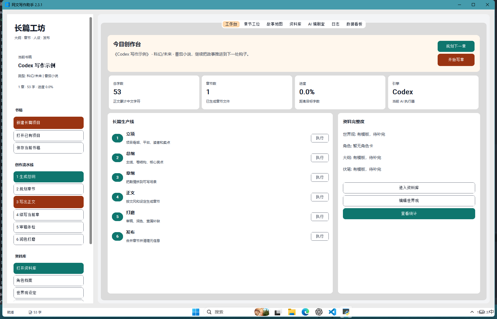
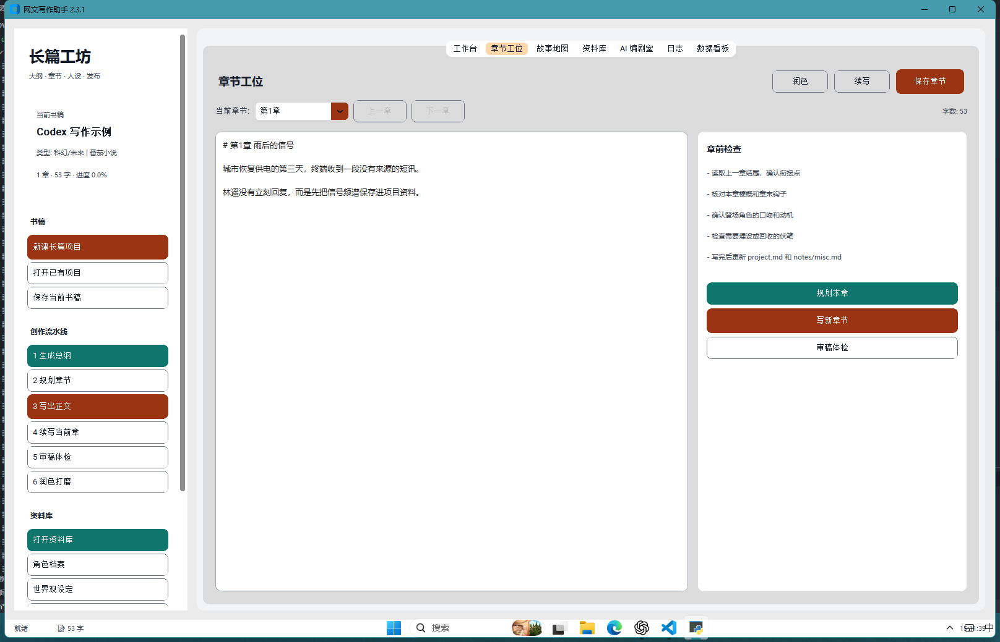
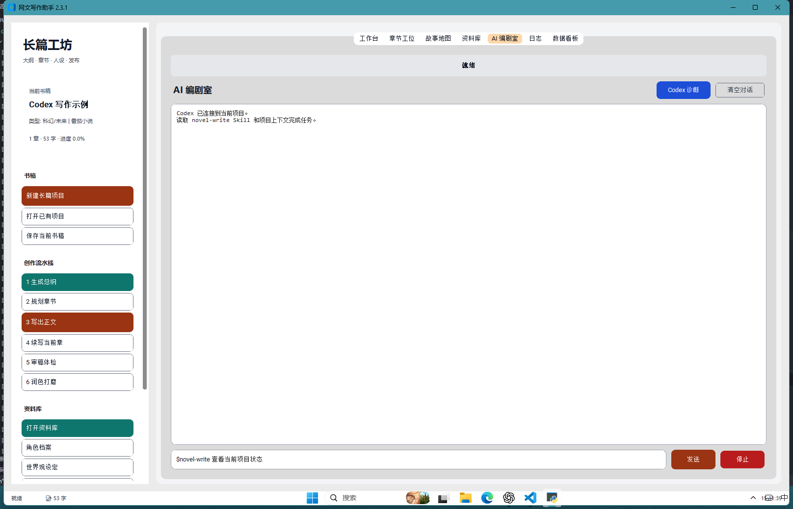

# 网文写作助手

基于 OpenAI Codex CLI 与 Codex Skill 的智能小说创作工具，面向网络文学作者提供从项目设定、大纲规划、章节撰写到审稿导出的桌面工作流。


## 界面预览（v2.3.0）

以下截图来自当前 v2.3.0 程序，展示 Codex 工作台、章节工位和 Codex 编剧室。







## 版本亮点

当前版本 **v2.3.0**。修复卷纲误写总纲、未保存修改丢失、外部文件冲突、任务取消和导出一致性等问题，详见 [更新记录](RELEASE_v2.3.0.md)。Windows EXE 可从 [Releases](https://github.com/ShmilyWithme/Shmily_novel_skill/releases/latest) 下载。

当前版本通过本机 Codex CLI 执行写作任务，项目 Skill 位于 `.agents/skills/novel-write`。应用自动把任务提示通过标准输入传给 Codex，并在小说项目目录内运行。

## 前置条件

| 软件 | 版本要求 | 用途 |
| --- | --- | --- |
| Node.js | 18+ | Codex CLI 运行环境 |
| OpenAI Codex CLI | 最新版 | AI 写作与文件编辑 |

安装 Codex CLI 并登录：

```bash
npm install -g @openai/codex@latest
codex login
```

应用读取本机 Codex CLI 的登录信息与配置（默认位于 `~/.codex`）。自定义 provider 需要兼容 OpenAI Responses 接口 `/v1/responses`。

从源码运行时还需要 Python 3.10+ 和 `customtkinter`：

```bash
pip install -r requirements.txt
python novel_writer_gui.py
```

## 功能

| 功能 | 说明 |
| --- | --- |
| 项目工作台 | 汇总字数、章节数、目标进度和资料完整度 |
| 长篇生产线 | 管理立项、总纲、卷纲、章节规划、正文、打磨与发布 |
| 章节工位 | 编辑正文、切换章节、续写、审稿和润色 |
| 故事地图 | 查看和编辑总纲、卷纲与章节规划 |
| 资料库 | 管理角色、世界观、文风设定和伏笔笔记 |
| Codex 编剧室 | 通过本机 Codex CLI 执行任务，并显示实时输出和文件变化 |
| 数据看板 | 汇总章节数、总字数、平均章节字数与进度 |
| 全文导出 | 合并章节并移除 HTML 元数据注释 |

## 使用流程

1. 安装并登录 Codex CLI。
2. 在应用中新建或打开小说项目。
3. 在工作台或故事地图中补齐项目设定与大纲。
4. 在章节工位选择章节，或在 Codex 编剧室输入任务。
5. 使用数据看板检查进度，并导出全文。

快捷任务会自动添加 `$novel-write` 前缀。也可以直接输入自然语言任务，例如“规划第 12 章”或“审阅当前章节并列出需要修改的地方”。

## 项目结构

```text
novel_write/
├── novel_writer_gui.py
├── build_release.py
├── README.md
├── .agents/
│   └── skills/novel-write/
│       ├── SKILL.md
│       ├── agents/openai.yaml
│       ├── modules/
│       └── templates/
├── tests/
└── dist/                         # 本地构建输出（不提交 EXE）
```

新建项目时，应用会创建 `project.json`（程序配置）和 `project.md`（可读项目总览），以及 `chapters/`、`outline/`、`characters/`、`worldbuilding/`、`style/`、`notes/` 和 `export/` 目录，并释放 `.agents/skills/novel-write`。大纲文件使用 `outline/master-outline.md`、`outline/volN-outline.md` 和 `outline/chapter-outs/chNNN.md`；同时创建 `notes/misc.md` 与 `notes/canon.md`。

新建项目只创建本地文件；确认任务后点击“发送”才会调用 Codex。`Ctrl+S` 保存当前大纲或书稿。切换项目或退出时会提示处理未保存内容，外部文件发生变化时会先提示冲突。

## 打包成 EXE

在 Windows 上运行：

```bat
build.bat
```

或直接运行：

```bash
python build_release.py
```

构建会把 Codex Skill 打包进单文件 EXE，输出到 `dist/网文写作助手.exe`。用户仍需自行安装并登录 Codex CLI。

构建前安装 `requirements-build.txt` 中的依赖。脚本验证包内 Skill 与源码一致，并生成 `dist/SHA256SUMS.txt`；详细步骤见 [构建说明](BUILD_README.md)。

## 开发检查

```powershell
python -m unittest discover -s tests -v
python -m py_compile novel_writer_gui.py build_release.py
git diff --check
```

测试使用临时项目和模拟的任务输入，不调用模型服务。Windows 下也会执行真实 Tk 窗口测试。GitHub Actions 自动运行检查并生成 Windows 构建附件。

## 常见问题

### 找不到 Codex CLI

确认 `codex` 已安装且位于 PATH 中，然后重新启动应用。可运行 `codex --version` 检查安装。

### Codex 返回 503 或连接本地服务失败

在“AI 编剧室”运行“Codex 诊断”，检查 `~/.codex/config.toml`、`codex login` 状态以及 `base_url` 对应服务是否可访问。自定义 provider 需要支持 `/v1/responses`。

### 终端输出没有实时显示

应用会读取 Codex CLI 的标准输出流并实时追加到终端。先确认 CLI 本身能够正常执行，再更新到最新版本。

### 添加新的小说类型模板

在 `.agents/skills/novel-write/templates/genre-templates/` 下新增 Markdown 模板。

## 反馈

- GitHub Issues: [提交问题](https://github.com/ShmilyWithme/Shmily_novel_skill/issues)
- QQ: 1943477162
- Email: z2960775@gmail.com

## License

[MIT](LICENSE)
